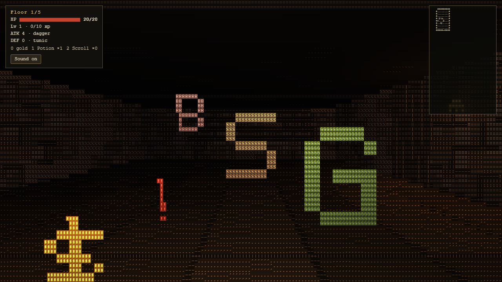

# Glyph Arcade

**[Play it here](https://taan1el.github.io/glyph-arcade/)**

Small browser games drawn entirely in coloured letters. Every game builds into **one self-contained offline HTML file**: no installs, no network requests, and no external image or font files. All games share a two-pass WebGL2 character-cell engine in `engine/`.



## Games

| Game | Genre & Overview |
|---|---|
| **Delve** | A first-person, turn-based roguelike across five seeded dungeon floors with permadeath, equipment upgrades, potions, mapping scrolls, and a lich on floor 5. Every monster and item is a small drawn character, shaded in coloured letters. |
| **Inkfire** | A fast-paced, real-time first-person arena shooter. Navigate a procedurally generated sector, collect Red and Blue keycards, wield four distinct weapons, detonate slime barrels, defeat the cybernetic Titan, and reach the exit pad. |
| **Wordfall** | A two-minute lane game. Letters fall in nine lanes: catch the next letter of the word and dodge the rest. Finish words in a row to build a combo. |
| **Burrow** | A side-view digging and building game. Fell trees, mine copper, iron and crystal, survive the night, and forge the key that wakes The Maw at the bottom of the world. Flood-filled light, flowing water and lava, falling sand, and a world that saves itself. |
| **Joyride** | A top-down open-world driving town across four districts with lanes, traffic lights, pedestrians, ringing payphones, twelve contact jobs, an armoured-van heist at the Docks, and five stars of police heat. |
| **Bannerfall** | A single-player three-lane battle. Choose Warden, Ranger, Ember or Shade, escort waves, buy equipment and bring down the rival Banner. |
| **Ricochet** | A 1v1 overhead neon disc court. Catch, charge, curve spin shots, bank off bumpers to break goal shields, and clear four tournament courts. |
| **Lockwork** | A clockwork signal-routing puzzle across 30 ancient brass vaults. Slide copper conduits, turn mirrors, weight plates and sync pulse delays. |
| [Next Stop](https://github.com/Taan1el/next-stop) | A rural steam railway in coloured letters ([play](https://taan1el.github.io/next-stop/)). Lives in its own repository. |

## How to Play

### Delve Controls

| Key / Input | Action |
|---|---|
| `W` / `S`, `↑` / `↓` | Step forward / back. Walking into a monster attacks it; walking into a door opens its portcullis. |
| `A` / `D` | Sidestep left / right. |
| `Q` / `E`, `←` / `→` | Turn left / right (free action; all other actions advance the turn). |
| `1` / `2` | Drink a healing potion / read a scroll of mapping. |
| `Enter` / `.` | Descend when standing on stairs (`>`). |
| `Space` · `M` · `Esc` | Wait one turn · toggle large minimap · open help / menu. |

### Inkfire Controls

| Key / Input | Action |
|---|---|
| `W` / `S`, `↑` / `↓` | Move forward / backward. |
| `A` / `D` | Strafe left / right. |
| `Q` / `E`, `←` / `→`, Mouse | Turn left / right (click the viewport to enable mouse-look). |
| `Space` / `F` / Left Click | Fire equipped weapon. |
| `1` / `2` / `3` / `4` | Switch weapon: Pistol, Shotgun, Chaingun, Rocket Launcher. |
| `Enter` | Open nearby door (colored doors require matching Red or Blue keycard). Doors also open as you walk up to them. |
| `P` / `Esc` · `M` | Pause / resume game · toggle large radar map. |

### Wordfall Controls

| Key / Input | Action |
|---|---|
| `←` / `→`, `A` / `D` | Slide one lane. Hold to keep sliding. |
| `P` / `Esc` | Pause. |

### Burrow Controls

| Key / Input | Action |
|---|---|
| `A` / `D`, `←` / `→` | Walk. One-tile ledges step up on their own. |
| `Space` / `W` / `↑` | Jump, swim up, or climb a ladder. `S` / `↓` climbs down. |
| Hold left click | Use the selected item: dig, place blocks, eat, open doors. |
| Right click / `F` | Swing your sword, whatever you are holding. |
| `1` to `9`, mouse wheel | Choose an item. |
| `C` · `P` / `Esc` | Open crafting · pause. |

### Joyride Controls

| Key / Input | Action |
|---|---|
| `W` / `S`, `↑` / `↓` | Throttle and brake/reverse in a car; walk on foot. |
| `A` / `D`, `←` / `→` | Steer left / right; walk sideways on foot. |
| `Space` | Handbrake: kicks the tail out for drifts and tight turns. |
| `E` / `Enter` | Enter or leave a car, or answer a ringing payphone (`$`). |
| `Shift` · `H` | Sprint on foot · honk horn. |
| `M` · `P` / `Esc` | Full town map · pause. |

### Bannerfall Controls

| Key / Input | Action |
|---|---|
| Right click / tap | Move or target an enemy. |
| Arrow keys | Move directly. |
| `A` + left click | Attack-move. |
| `Q` / `W` / `E` / `R` | Cast toward cursor; ultimate unlocks at level 6. |
| `B` | Recall to base; damage interrupts. |
| `Tab` · `P` / `Esc` | Scoreboard · pause. |
| Touch / gamepad | Movement and ability controls shown in game help. |

### Ricochet Controls

| Key / Input | Action |
|---|---|
| `W A S D` / Arrow keys | Move on your half of the court and steer aim / curve while holding the disc. |
| `J` / `Enter` / Left click | Hold to charge throw, release to fire; tap on impact to parry. |
| `K` / `E` / Right click | Curve-spin throw. |
| `Space` / `Shift` | Dash to intercept fast discs. |
| `P` / `Esc` | Pause. |
| Touch / gamepad | Left pad moves/aims; Throw, Spin, and Dash buttons (or `A` / `X` / `B` on gamepad). |

### Lockwork Controls

| Key / Input | Action |
|---|---|
| `W A S D` / Arrow keys | Step 1 tile (pushing crates `[#]` and conduits `[+][-][|]`). |
| `Space` / `E` / `Enter` | Rotate adjacent mirror or splitter, or wait 1 tick. |
| `Z` / `Backspace` · `R` | Undo step · Reset vault. |
| `H` · `L` / `Tab` · `P` / `Esc` | Hint · Vault Select · Pause. |
| Touch / gamepad | Tap/swipe vault or use pads; `A` rotates/waits, `B` undoes, `Y` resets on gamepad. |

### Touch, gamepad and difficulty

Every game has two-thumb touch controls, standard-mapping gamepad support (listed on each game's help screen; controls cannot be remapped yet), a mute toggle, and Easy, Normal and Hard on the title screen. High scores persist in `localStorage`, and Delve, Inkfire and Burrow also save the active run.

## How to Run, Build, and Test

Requires **Node.js 20** or newer.

```sh
npm install          # Install dev dependencies (Playwright)
npm run build        # Bundle every game, dist/index.html, and PWA assets
npm test             # Verify MIT license and run headless rule & bot test suites for all games
npx playwright install chromium
npm run test:browser # Boot the portal and every game, fail on console errors, and measure the touch HUD at phone sizes
npm run previews     # Capture a preview image for every game
npm run test:balance # Quick difficulty guards (about a minute)
npm run balance      # Full 200-seed balance report (several minutes)
npm run perf         # Frame-time report, see PERF.md
```

Once built, open `dist/index.html` (or any `dist/<game>.html`) directly in a browser, or serve `dist/` with any static HTTP server to enable the offline PWA service worker.

## How to Add a Game in Under 10 Steps

1. **Create the game folder**: Add `games/<id>/src/` and `games/<id>/test/`.
2. **Write pure rules (`games/<id>/src/rules.js`)**: Implement deterministic game state creation, step/turn functions, scoring, and `restore()` validation with zero DOM dependencies, and attach your module to `global.<GameName>`.
3. **Add unit tests (`games/<id>/test/rules.test.cjs`)**: Test map/level generation, determinism, rules edge cases, save/restore round-trips, and a headless bot run using Node's `vm` and `assert/strict`.
4. **Build the scene renderer (`games/<id>/src/scene.js`)**: Instantiate `new GlyphEngine(canvas, { sceneSource, uniforms, far })` (and optionally `GlyphArt.Atlas` for procedural sprites) to write character cells via `writeCell(...)` in your GLSL fragment shader. See [`engine/README.md`](engine/README.md) for the full engine API.
5. **Create the app loop (`games/<id>/src/app.js`)**: Connect keyboard/touch inputs, Web Audio sound effects, HUD updates, pause/mute, and `localStorage` persistence to your rules and scene.
6. **Create the HTML shell (`games/<id>/src/shell.html`)**: Include the three bundler markers (`<!--__LICENSE__-->`, `<!--__META__-->`, and `<script>/*__CODE__*/</script>`) along with your HUD and modal cards.
7. **Register the game (`tools/build.cjs` & `package.json`)**: Add an entry to `GAMES` in `tools/build.cjs` listing your `parts` (include `engine/glyph-input.js` and `engine/glyph-quality.js`) and `shell`, and add your test file to `"test"` in `package.json`.
8. **Add preview & smoke checks (`tools/capture-previews.cjs` & `tests/browser-smoke.cjs`)**: Stage a preview screenshot in `tools/capture-previews.cjs` and add a gameplay smoke assertion in `tests/browser-smoke.cjs` and your id to `tools/layout-check.cjs`, then run `npm run build && npm test && npm run previews && npm run test:browser`.

## License

MIT licensed. See [`LICENSE`](LICENSE).
