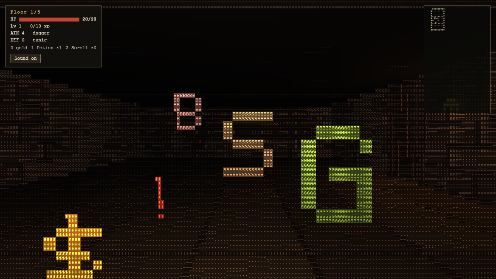

# Glyph Arcade

Small browser games drawn entirely in coloured letters. Each game builds into **one offline HTML file**: no installs, no network, no image or font assets. They share one letter-rendering engine.



## Games

| Game | What it is |
|---|---|
| **Delve** | A first-person, turn-based roguelike. Five seeded floors, permadeath, loot and a lich at the bottom. Every monster and item is a giant 3D letter made of small ones: a skeleton is a towering `S`, a potion a bobbing `!`. |
| [Next Stop](https://github.com/Taan1el/next-stop) | A rural steam railway in letters ([play](https://taan1el.github.io/next-stop/)). It lives in its own repository. |

### Delve controls

| Key | Action |
|---|---|
| W / S, ↑ / ↓ | Step forward / back. Walking into a monster attacks; into a door raises its portcullis. |
| A / D | Sidestep |
| Q / E, ← / → | Turn (free). Every other action is one turn. |
| 1 / 2 | Healing potion / scroll of mapping |
| Enter | Descend stairs |
| Space · M · Esc | Wait · resize map · help |

Touch screens get an on-screen pad. **Daily delve** gives everyone the same dungeon for the day; every seed rebuilds the same floors.

## How it renders

`engine/glyph-engine.js` is the shared engine. A game supplies a WebGL2 fragment shader that writes one record per character cell: glyph, material, flags, log depth, foreground and background colour. The engine then draws every cell as a 5×7 letter from numeric bitmasks. It also adds:

- **Ink outlines:** depth breaks get oriented strokes (`/ - \ |`). Planes are affine in inverse depth across the screen, so floors seen at a grazing angle stay clean.
- **Display effects:** damage tints, and a letter-by-letter dissolve between floors.

Delve's scene (`games/delve/src/scene.js`) works like this:

- **Walls:** a grid walk finds walls; bricks, flagstones and portcullises become letters, with joints drawn only when they are resolvable at that distance.
- **Monsters and items:** camera-facing billboards masked by their own glyph bitmap.
- **Light:** your lantern plus flickering torches.

The rules (`games/delve/src/rules.js`) are pure and deterministic, with no DOM, so Node tests and bots can play whole runs.

## Build and test

Node 20 or newer.

```sh
npm ci
npm run build        # dist/delve.html and the dist/index.html launcher
npm test             # rules, floor connectivity, determinism, saves, 60 bot runs
npx playwright install chromium
npm run test:browser # boots the built game, plays turns, fails on any page error
npm run previews     # dist/previews/*.png for the launcher and link previews
```

`.github/workflows/pages.yml` builds, tests and publishes `dist/` to GitHub Pages from `main`, once Pages is set to deploy from GitHub Actions.

MIT licensed.
